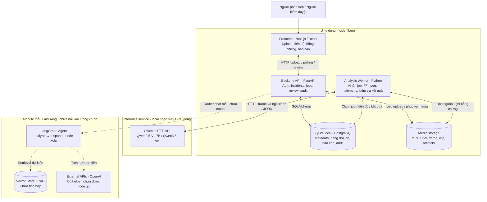

# IncidentLens

> Trợ lý AI hỗ trợ phân tích sự cố giao thông từ video và telemetry, tổng hợp bằng chứng và tạo báo cáo để con người kiểm duyệt.

**Team P-076 · Đề tài RAV-18**

IncidentLens giúp người phân tích và người kiểm duyệt xem lại video MP4, đối chiếu log CSV, tìm các thời điểm cần chú ý và quản lý báo cáo trong cùng một workspace. Mỗi kết quả phân tích đi kèm bằng chứng để người dùng có thể kiểm tra trước khi phê duyệt.

## Mô tả dự án

Việc xem lại video và log thủ công khiến quá trình điều tra sự cố mất thời gian, khó đối chiếu thông tin và khó theo dõi thay đổi báo cáo. IncidentLens hỗ trợ quy trình này bằng các chức năng:

- **Tiếp nhận dữ liệu:** tải video MP4 và telemetry CSV tùy chọn.
- **Phân tích bằng AI:** dùng mô hình thị giác–ngôn ngữ Qwen qua Ollama để phân tích hình ảnh, kết hợp telemetry khi có dữ liệu phù hợp.
- **Theo dõi xử lý:** tạo job phân tích, hiển thị tiến độ và trạng thái xử lý.
- **Kiểm tra bằng chứng:** xem video, frame, timeline và thông tin phân tích trong workspace.
- **Kiểm duyệt báo cáo:** chỉnh sửa bản nháp, gửi duyệt, phê duyệt hoặc từ chối; theo dõi phiên bản và lịch sử thao tác.
- **Quản lý truy cập:** đăng nhập và phân quyền theo vai trò.

Kết quả AI là đầu vào hỗ trợ kiểm duyệt. Kết quả không phát hiện sự cố chỉ phản ánh phạm vi dữ liệu đã phân tích, không bảo đảm toàn bộ video không có sự cố.

## Screenshot

### Trang giới thiệu


### Workspace kiểm duyệt


Ảnh chụp giao diện đã lưu trong repository; dữ liệu hiển thị có thể là dữ liệu demo tại thời điểm chụp.

## Architecture Diagram

Đường liền mô tả luồng phân tích hiện tại; nét đứt là kết nối chưa tích hợp.



API tạo job trong database; worker gọi Qwen, lưu bằng chứng và báo cáo nháp. Frontend polling tiến độ, hiển thị kết quả để con người kiểm duyệt.

**Trạng thái thực tế:** LangGraph hiện là khung mẫu, router chat chưa được mount vào API chính. Vector Store chưa tích hợp; OpenAI helper chưa được các node gọi. Database quan hệ và media storage không phải Vector Store.

Xem [kiến trúc chi tiết, luồng xử lý và nguồn code đối chiếu](docs/architecture_diagram.md).

## Tech stack

| Thành phần | Công nghệ |
|---|---|
| Frontend | Next.js 14, React 18, TypeScript, Tailwind CSS |
| Backend / API | Python 3.11, FastAPI, Uvicorn, Pydantic |
| AI / video | Qwen2.5-VL 7B qua Ollama, FFmpeg / FFprobe; hỗ trợ cấu hình Qwen3.5 9B |
| Agent framework | LangGraph, LangChain, tích hợp OpenAI trong các module agent |
| Database | SQLAlchemy, Alembic; SQLite cho local, PostgreSQL cho triển khai dùng database riêng |
| Kiểm thử | pytest, pytest-asyncio, Playwright |
| Chất lượng code | Ruff, ESLint, TypeScript typecheck |
| Đóng gói / CI | Docker Compose, GitHub Actions |

## Hướng dẫn cài đặt

### Yêu cầu

Chọn một trong hai cách chạy:

- **Docker:** Git, Docker Engine/Desktop có Docker Compose v2. Nếu dùng GPU NVIDIA, cần driver và NVIDIA Container Toolkit phù hợp; Docker Desktop Windows dùng WSL2.
- **Native:** Git, Python 3.11, Node.js 20 và npm, Ollama, FFmpeg và FFprobe có trong `PATH`.

Model 7B cần đủ RAM/VRAM và dung lượng lưu trữ. Có thể chạy bằng CPU nhưng suy luận chậm hơn GPU. Lần đầu cần Internet để tải dependency và model.

### Clone repository

```powershell
git clone https://github.com/namhv521/IncidentLens.git
cd IncidentLens
```

### Cách 1: Docker local với SQLite

Từ thư mục gốc, chạy:

```powershell
docker compose -f docker-compose.qwen-local.yml up -d --build
docker compose -f docker-compose.qwen-local.yml logs -f --tail 50
```

Container đóng gói frontend, API, worker, Ollama và công cụ xử lý video. Lần đầu tự tải model; đợi thông báo `IncidentLens ready` trước khi gửi phân tích.

Mở [IncidentLens local](http://127.0.0.1:8089/incidents).

Nếu cần tạo tài khoản quản trị đầu tiên, mở terminal khác và chạy sau khi ứng dụng sẵn sàng:

```powershell
docker compose -f docker-compose.qwen-local.yml exec app python -m backend.cli.users create-admin --email admin@example.com --name "Local Admin"
```

CLI yêu cầu nhập mật khẩu ẩn. Đăng nhập và đổi mật khẩu tạm theo hướng dẫn của ứng dụng.

**GPU NVIDIA:** thay lệnh khởi động bằng:

```powershell
docker compose -f docker-compose.qwen-local.yml -f docker-compose.qwen-gpu.yml up -d --build
```

**Lưu ý Compose:** `docker-compose.yml` mặc định còn nạp cấu hình PostgreSQL cloud và yêu cầu `P076_DATABASE_URL`. Dùng lệnh có `-f docker-compose.qwen-local.yml` ở trên để chạy độc lập với SQLite.

Dừng ứng dụng, giữ dữ liệu và model:

```powershell
docker compose -f docker-compose.qwen-local.yml down
```

Không thêm `-v` nếu cần giữ volume dữ liệu và model. Hướng dẫn vận hành chi tiết: [Docker + Qwen](docs/docker_qwen7b.md).

### Cách 2: Native trên Windows PowerShell

Tại thư mục gốc, tạo môi trường Python và cấu hình local. Nếu đã có `.env`, giữ bản hiện tại và đối chiếu với file mẫu trước khi sửa.

```powershell
py -3.11 -m venv .venv
.\.venv\Scripts\Activate.ps1
python -m pip install -r requirements.txt
Copy-Item .env.ollama.example .env
Copy-Item frontend/.env.example frontend/.env.local
python -m alembic upgrade head
```

Trong `.env`, đặt `LANGCHAIN_TRACING_V2=false` nếu chưa cấu hình LangSmith. Mẫu Ollama dùng SQLite và endpoint `http://127.0.0.1:11434/v1/chat/completions`; không cần OpenAI API key cho luồng Qwen local.

Cài frontend:

```powershell
cd frontend
npm ci
cd ..
```

Trong `frontend/.env.local`, dùng API thật và bật xác thực:

```dotenv
NEXT_PUBLIC_USE_MOCK_API=false
NEXT_PUBLIC_API_BASE_URL=http://localhost:8000/api/v1
NEXT_PUBLIC_ENABLE_AUTH=true
BACKEND_INTERNAL_URL=http://127.0.0.1:8000
```

## Cách chạy

Nếu chọn Docker, dùng lệnh khởi động trong phần cài đặt. Nếu chọn native, mở các terminal PowerShell riêng tại thư mục gốc:

**Terminal 1 — Ollama:**

```powershell
ollama serve
```

Nếu Ollama đã chạy nền, dùng tiến trình hiện tại. Tại terminal khác, tải model một lần:

```powershell
ollama pull qwen2.5vl:7b
```

**Terminal 2 — API:**

```powershell
.\.venv\Scripts\Activate.ps1
python -m uvicorn api.main:app --reload --host 127.0.0.1 --port 8000
```

**Terminal 3 — worker phân tích:**

```powershell
.\.venv\Scripts\Activate.ps1
python -m backend.gpu_worker
```

API tiếp nhận job; worker xử lý job. Chỉ khởi động API sẽ không hoàn tất phân tích video.

**Terminal 4 — frontend:**

```powershell
cd frontend
npm run dev
```

Tạo quản trị viên lần đầu sau khi migration hoàn tất, trong terminal đã kích hoạt `.venv`:

```powershell
python -m backend.cli.users create-admin --email admin@example.com --name "Local Admin"
```

- Giao diện native: [http://localhost:3000/incidents](http://localhost:3000/incidents).
- Swagger API native: [http://127.0.0.1:8000/docs](http://127.0.0.1:8000/docs), khi chạy môi trường development.

### Luồng sử dụng

1. Đăng nhập bằng tài khoản đã được tạo.
2. Mở trang tạo sự cố, tải MP4 và CSV nếu có.
3. Gửi yêu cầu phân tích và theo dõi tiến độ.
4. Mở workspace, đối chiếu video, timeline và bằng chứng.
5. Chỉnh sửa báo cáo, gửi duyệt và thực hiện thao tác theo quyền được cấp.

## Cấu trúc thư mục

```text
IncidentLens/
├── api/                     # FastAPI app, routes và hợp đồng API
├── backend/
│   ├── agents/              # Các module agent LangGraph
│   ├── alembic/             # Database migrations
│   ├── cli/                 # CLI quản trị tài khoản
│   ├── models/              # Database models và schema
│   ├── prompts/             # Prompt phân tích
│   ├── services/            # Xử lý video, telemetry, AI và báo cáo
│   ├── config.py            # Cấu hình ứng dụng
│   ├── gpu_worker.py        # Consumer job cho Ollama và media local
│   ├── worker.py            # Xử lý job phân tích V1
│   └── worker_v2.py         # Luồng xử lý V2
├── frontend/                # Next.js app, components, assets và E2E tests
├── deploy/                  # Docker runtime và cấu hình triển khai
├── docs/                    # Tài liệu kỹ thuật, vận hành và guidebook
├── tests/                   # Backend/API tests
├── eval/                    # Tài liệu và kết quả đánh giá
├── presentation/            # Tài liệu demo, slide và video
├── scripts/                 # Công cụ hỗ trợ và hook AI logging
├── .github/workflows/       # CI workflows
├── .env.ollama.example      # Cấu hình native Ollama local
├── docker-compose.yml       # Compose mặc định có PostgreSQL cloud override
├── docker-compose.qwen-local.yml # Stack local với SQLite
├── requirements.txt         # Python dependencies
├── JOURNAL.md               # Nhật ký phát triển
└── WORKLOG.md               # Công việc của nhóm
```

## Team members

Nhóm **P-076**, gồm bốn thành viên. Phần đóng góp dưới đây tổng hợp từ lịch sử Git và worklog; không thay thế bảng phân công chính thức của nhóm.

| Thành viên / tên trong Git | Tài khoản được ghi nhận | Đóng góp trong repository |
|---|---|---|
| Nam Hoang | `namhv521` / `susois` | Tích hợp hệ thống, pipeline AI/telemetry, sửa lỗi và kiểm thử |
| Nguyễn Văn Hồng | `hongneuk65` | Frontend, workspace báo cáo, UX và cấu hình hook |
| Nguyễn Hoàng | `hoang9605` | Backend, tài liệu kiến trúc và journal |
| LeTuanDat | `LeTuanDat` / `TuanDatt08` | Tích hợp Qwen 9B và đồng bộ source |

## Kiểm tra và tài liệu liên quan

Chạy backend checks tại thư mục gốc, trong môi trường Python đã cài dependency:

```powershell
python -m pytest
python -m ruff check backend api tests
```

Chạy frontend checks tại `frontend/`:

```powershell
npm run typecheck
npm run lint
npm run build
```

- [Tài liệu API](api/README.md)
- [Tài liệu frontend](frontend/README.md)
- [Vận hành Docker + Ollama](docs/docker_qwen7b.md)
- [Architecture diagram](docs/architecture_diagram.md)
- [Worklog](WORKLOG.md) và [Development journal](JOURNAL.md)
- [Pitch deck Demo Day 10 slide](presentation/output/pitch_deck.pptx) và [kịch bản thuyết trình](presentation/README.md)
- [Hướng dẫn đóng góp](CONTRIBUTING.md) và [Chính sách bảo mật](SECURITY.md)

Các địa chỉ localhost trong README dành cho chạy local. Cấu hình triển khai cloud cần database, lưu trữ media, worker và inference được kết nối đầy đủ.

## License

Dự án sử dụng [MIT License](LICENSE).
