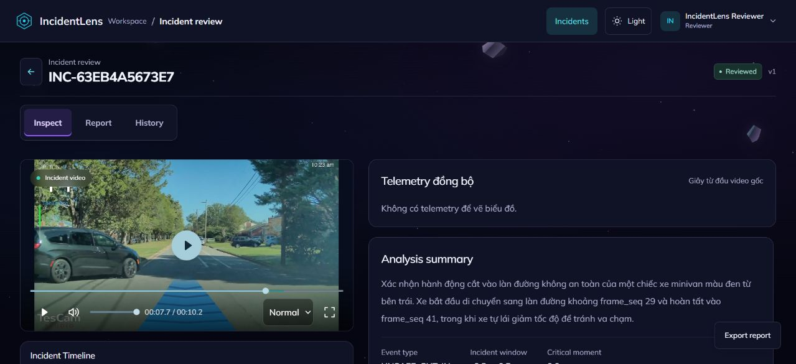
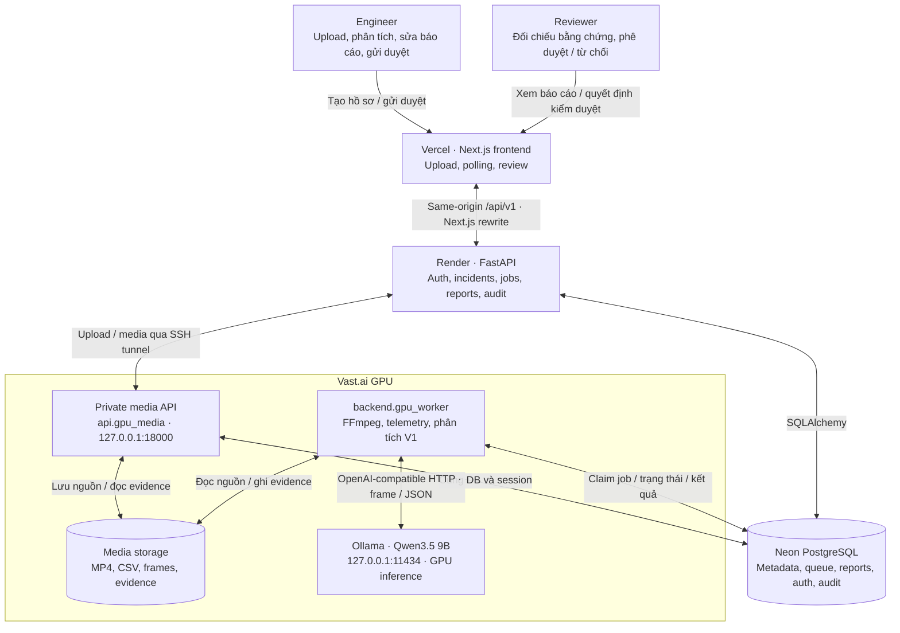

# IncidentLens

> Trợ lý AI hỗ trợ phân tích sự cố giao thông từ video và telemetry, tổng hợp bằng chứng và tạo báo cáo để con người kiểm duyệt.

**Team P-076 · Đề tài RAV-18**

IncidentLens giúp người phân tích và người kiểm duyệt xem lại video MP4, đối chiếu log CSV, tìm các thời điểm cần chú ý và quản lý báo cáo trong cùng một workspace. Mỗi kết quả phân tích đi kèm bằng chứng để người dùng có thể kiểm tra trước khi phê duyệt.

## Mô tả dự án

Việc xem lại video và log thủ công khiến quá trình điều tra sự cố mất thời gian, khó đối chiếu thông tin và khó theo dõi thay đổi báo cáo. IncidentLens hỗ trợ quy trình này bằng các chức năng:

- **Tiếp nhận dữ liệu:** tải video MP4 và telemetry CSV tùy chọn.
- **Phân tích bằng AI:** dùng mô hình thị giác–ngôn ngữ Qwen qua Ollama để phân tích hình ảnh, kết hợp telemetry khi có dữ liệu phù hợp.
- **Theo dõi xử lý:** tạo job phân tích, hiển thị tiến độ và trạng thái xử lý.
- **Kiểm tra bằng chứng:** xem video, frame, timeline và thông tin phân tích trong workspace.
- **Kiểm duyệt báo cáo:** chỉnh sửa bản nháp, gửi duyệt, phê duyệt hoặc từ chối; theo dõi phiên bản và lịch sử thao tác.
- **Quản lý truy cập:** đăng nhập và phân quyền theo vai trò.

Kết quả AI là đầu vào hỗ trợ kiểm duyệt. Kết quả không phát hiện sự cố chỉ phản ánh phạm vi dữ liệu đã phân tích, không bảo đảm toàn bộ video không có sự cố.

## Screenshot

### Trang giới thiệu


### Workspace kiểm duyệt



Ảnh workspace chụp từ [hồ sơ INC-63EB4A5673E7](https://c4-app-076.vercel.app/incidents/INC-63EB4A5673E7), tài khoản **Reviewer**, video tại mốc **7,7 giây**. Trang giới thiệu ở trên là ảnh giao diện landing page.

## Architecture Diagram

Kiến trúc triển khai hiện tại: **Vercel chạy frontend; Render chạy API; Vast.ai chạy media service, worker và Qwen3.5 trên GPU; Neon lưu PostgreSQL dùng chung**.



API Render tạo job trong Neon. Upload V1 và một số route media được chuyển qua SSH tới Vast; worker chỉ nhận job khi có file trên GPU và Ollama sẵn sàng. Frontend polling tiến độ qua API. **Render không chạy worker hoặc model** trong cấu hình này.

Engineer chuẩn bị và gửi báo cáo. Reviewer đối chiếu video/bằng chứng rồi phê duyệt hoặc từ chối. Backend kiểm tra quyền và lưu phiên bản, quyết định kiểm duyệt cùng audit vào Neon.

Xem [kiến trúc chi tiết](docs/architecture_diagram.md).

## Tech stack

| Thành phần | Công nghệ / nơi chạy |
|---|---|
| Frontend | Next.js 14, React 18, TypeScript, Tailwind CSS / Vercel |
| Backend API | Python 3.11, FastAPI, Uvicorn, Pydantic / Render |
| AI inference | **qwen3.5:9b**, Ollama, GPU / Vast.ai |
| Worker / media | Python, FFmpeg / FFprobe, private FastAPI / Vast.ai |
| Database | PostgreSQL trên Neon, SQLAlchemy, Alembic |

## Hướng dẫn cài đặt và cấu hình

### Clone repository

Repository gốc trong workspace chung **AI20K-Build-Phase-Cohort-4** đang **private**. Dùng tài khoản GitHub đã được cấp quyền:

```powershell
git clone https://github.com/AI20K-Build-Phase-Cohort-4/P-076.git
cd P-076
```

### Cấu hình theo dịch vụ

Không dùng một file env chung cho mọi máy. Điền secret trong dashboard hoặc file riêng trên server:

| Dịch vụ | Env mẫu | Các biến cần đồng bộ |
|---|---|---|
| Vercel | [frontend/.env.example](frontend/.env.example) | `BACKEND_INTERNAL_URL` là origin HTTPS của Render; API frontend dùng `/api/v1` |
| Render API | [.env.example](.env.example) | PostgreSQL, cookie HTTPS, CORS, private media URL và SSH secrets |
| Vast worker + media | [deploy/vast/worker.env.example](deploy/vast/worker.env.example) | Cùng PostgreSQL và CORS với Render; file media nằm trên Vast; model `qwen3.5:9b` |

- **Render và Vast:** `DATABASE_URL` trỏ cùng một Neon database để dùng chung incident, queue, report và session. `DATABASE_CLOUD=true`, URL yêu cầu SSL.
- **Production auth:** `APP_ENV=production`, `AUTH_COOKIE_SECURE=true`, `CORS_ORIGINS` là origin HTTPS chính xác của frontend.
- **Render:** `GPU_MEDIA_BASE_URL=http://127.0.0.1:18000`; `GPU_SSH_TARGET`, `GPU_SSH_PORT`, `GPU_SSH_PRIVATE_KEY`, `GPU_SSH_KNOWN_HOSTS` thiết lập tunnel tới Vast.
- **Vast:** `GPU_MEDIA_BASE_URL` phải trống; media và worker đọc cùng `INCIDENT_STORAGE_DIR`. Endpoint Qwen loopback `11434` là của máy GPU, không phải máy cá nhân.
- **Qwen3.5:** `QWEN_RUNTIME=ollama`, `QWEN_OLLAMA_MODEL=qwen3.5:9b`, `QWEN_REASONING_EFFORT=none`. Code hiện chấp nhận tag 9B này.
- **Vercel:** không đặt URL localhost, DB credential hoặc SSH key. Thay biến môi trường cần redeploy để Next.js cập nhật rewrite/build.

Mẫu `.env.ollama.example` đã ngừng dùng; `.env.vps.example` thuộc phương án VPS/Caddy cũ. Các Compose all-in-one còn ép Qwen2.5 nên không phải lệnh khởi động của deployment này. README không còn hướng dẫn chạy full stack hoặc model trên máy cá nhân.

### Render: API và SSH tunnel

Dùng Dockerfile ở root repository. Dockerfile hiện chạy:

```text
python -m deploy.render_start
```

Entry point này khởi động API và duy trì SSH media tunnel khi đã cung cấp đủ SSH secrets. Không override về lệnh Uvicorn đơn lẻ nếu cần tunnel. Khóa SSH phải được Vast cho phép forward tới `127.0.0.1:18000`, với host key đã xác minh.

Áp dụng migration bằng tác vụ riêng/pre-deploy có cùng biến môi trường trước khi đưa API mới vào sử dụng:

```bash
python -m alembic upgrade head
```

Không dùng lệnh migration làm tiến trình web lâu dài. Worker không được cài hoặc khởi động trên Render trong cấu hình này.

### Vast.ai: worker, media và Qwen GPU

Các lệnh dưới đây chạy **trên Linux của instance Vast**, với source tại `/workspace/incidentlens`, Python environment tại `/workspace/incidentlens-venv` và template có Supervisor tương thích `deploy/vast/install_worker.sh`.

Cài dependency trong môi trường GPU đã chuẩn bị:

```bash
cd /workspace/incidentlens
/workspace/incidentlens-venv/bin/python -m pip install -r requirements.txt
test -f worker.env || cp deploy/vast/worker.env.example worker.env
chmod 600 worker.env
```

Chỉ copy mẫu khi chưa có `worker.env`; nếu file đã tồn tại, đối chiếu và sửa các biến cần thiết để giữ secret và cấu hình vận hành. Điền cùng Neon URL/CORS với Render. Máy này cần FFmpeg/FFprobe, Ollama hỗ trợ model đang dùng và NVIDIA GPU/driver hoạt động.

Kiểm tra model đang được nhóm vận hành, không chạy thêm Ollama trùng cổng:

```bash
nvidia-smi
ollama list
curl --fail http://127.0.0.1:11434/api/show \
  -H 'Content-Type: application/json' -d '{"model":"qwen3.5:9b"}'
ollama ps
```

`/api/show` phải có capability `vision`. Sau request suy luận, dùng `ollama ps` và `nvidia-smi` kiểm tra model có sử dụng GPU. Model tồn tại trong danh sách chưa chứng minh suy luận dùng GPU.

Cài các service và khởi động worker sau khi env, model và media đã sẵn sàng:

```bash
bash deploy/vast/install_worker.sh
supervisorctl start incidentlens-gpu-worker
supervisorctl status incidentlens-gpu-media incidentlens-gpu-worker
```

Installer tự bật media service, nhưng **không tự bật worker**. Hai service cùng nạp `/workspace/incidentlens/worker.env`:

- Media: `api.gpu_media:app`, chỉ bind `127.0.0.1:18000`.
- Worker: `backend.gpu_worker`, xử lý queue V1 và ghi kết quả vào Neon.

Frontend đang tắt workspace V2. Không bật `NEXT_PUBLIC_ENABLE_V2_WORKSPACE` chỉ vì repo có worker V2: GPU media proxy hiện chỉ hỗ trợ các route V1 đã định nghĩa.

### Vercel: frontend

Đặt project root là `frontend`, dùng build `npm run build` và cấu hình theo `frontend/.env.example`. `BACKEND_INTERNAL_URL` chỉ gồm origin của Render, không thêm `/api/v1`. Frontend gửi API cùng origin; Next.js rewrite chuyển request sang Render. API backend vẫn quyết định quyền truy cập.

## Cách chạy và kiểm tra

Người dùng truy cập frontend đã deploy, đăng nhập, tải MP4/CSV, gửi phân tích và xem kết quả trong workspace. Để phân tích hoàn tất cần **đồng thời**: Render API, Neon, SSH tunnel, Vast media service, Vast worker và Ollama/Qwen3.5.

1. Kiểm tra API `/health` và `/api/v1/health` trên Render.
2. Qua frontend, `/api/v1/auth/me` trả `401` khi chưa đăng nhập là trạng thái bình thường; `404/500` cần kiểm tra rewrite, deploy hoặc migration.
3. Trên Vast, `curl --fail http://127.0.0.1:18000/health` kiểm tra media service.
4. Kiểm tra model vision, GPU và trạng thái Supervisor như phần trên.
5. Chạy một hồ sơ được phép dùng, đối chiếu job hoàn tất, video/evidence đọc được và report lưu trong đúng Neon database.

Khi Vast/tunnel mất kết nối, upload hoặc route media được proxy có thể trả `503 GPU_UNAVAILABLE`; metadata báo cáo vẫn phụ thuộc API/Neon. Khi worker dừng hoặc chưa có file nguồn/model, job không tự hoàn tất. API health thành công không phải bằng chứng pipeline AI hoạt động end-to-end.

### Luồng sử dụng

1. Đăng nhập bằng tài khoản được cấp; đổi mật khẩu tạm nếu được yêu cầu.
2. Tạo sự cố, tải MP4 và CSV tùy chọn.
3. Gửi phân tích, theo dõi tiến độ.
4. Đối chiếu video, timeline, bằng chứng và điểm chưa chắc chắn.
5. Sửa báo cáo, gửi duyệt, phê duyệt/từ chối theo vai trò.

## Cấu trúc thư mục

```text
P-076/
├── api/                      # FastAPI, routes và private GPU media adapter
├── backend/
│   ├── agents/               # LangGraph mẫu
│   ├── alembic/              # Database migrations
│   ├── cli/                  # Quản trị tài khoản
│   ├── models/               # Database models và schema
│   ├── prompts/              # Prompt phân tích và tổng hợp
│   ├── services/             # Video, telemetry, provider, reports
│   ├── config.py             # Settings và validation
│   ├── gpu_worker.py         # Worker V1 trên Vast
│   ├── worker.py             # Job processing V1
│   └── worker_v2.py          # Luồng V2 riêng
├── frontend/                 # Next.js, deploy trên Vercel
├── deploy/
│   ├── render_start.py       # Render API + SSH media tunnel
│   └── vast/                 # Worker env và Supervisor installer
├── docs/                     # Tài liệu kỹ thuật
├── tests/                    # Backend/API tests
├── eval/                     # Protocol và kết quả đánh giá
├── presentation/             # Pitch deck và kịch bản demo
├── .github/workflows/        # CI
├── .env.example              # Render API env mẫu
├── Dockerfile                # Image API cho Render
├── requirements.txt          # Python dependencies
├── JOURNAL.md                # Nhật ký phát triển
└── WORKLOG.md                # Công việc của nhóm
```

## Team members

Nhóm **P-076**, gồm bốn thành viên. Phần đóng góp dưới đây tổng hợp từ lịch sử Git và worklog; không thay thế bảng phân công chính thức của nhóm.

| Thành viên / tên trong Git | Tài khoản được ghi nhận | Đóng góp trong repository |
|---|---|---|
| Nam Hoang | `namhv521` / `susois` | Tích hợp hệ thống, pipeline AI/telemetry, sửa lỗi và kiểm thử |
| Nguyễn Văn Hồng | `hongneuk65` | Frontend, workspace báo cáo, UX và cấu hình hook |
| Nguyễn Hoàng | `hoang9605` | Backend, tài liệu kiến trúc và journal |
| LeTuanDat | `LeTuanDat` / `TuanDatt08` | Tích hợp Qwen 9B và đồng bộ source |

## Kiểm tra và tài liệu liên quan

Chạy backend checks tại thư mục gốc, trong môi trường Python đã cài dependency:

```powershell
python -m pytest
python -m ruff check backend api tests
```

Chạy frontend checks tại `frontend/`:

```powershell
npm run typecheck
npm run lint
npm run build
```

- [Tài liệu API](api/README.md)
- [Tài liệu frontend](frontend/README.md)
- [Architecture diagram](docs/architecture_diagram.md)
- [Worklog](WORKLOG.md) và [Development journal](JOURNAL.md)
- [Pitch deck Demo Day 10 slide](presentation/output/pitch_deck.pptx) và [kịch bản thuyết trình](presentation/README.md)
- [Hướng dẫn đóng góp](CONTRIBUTING.md) và [Chính sách bảo mật](SECURITY.md)

Các địa chỉ loopback trong README thuộc **server Render hoặc Vast tương ứng**. Tài liệu đối chiếu source và kiến trúc nhóm xác nhận; không thay thế kiểm tra trạng thái live của các dịch vụ.

## License

Dự án sử dụng [MIT License](LICENSE).
