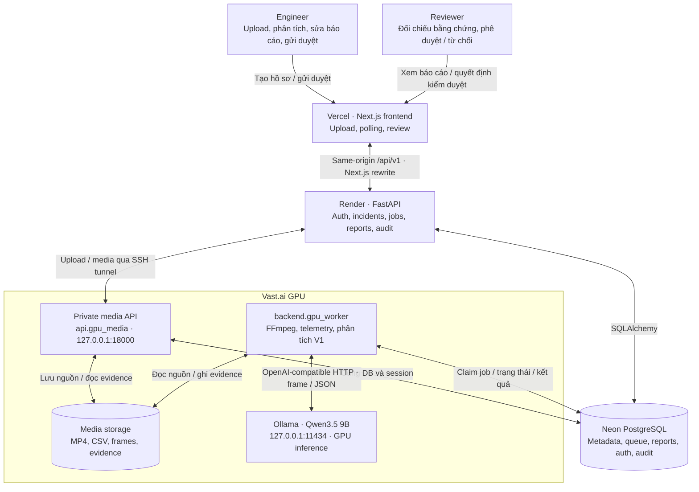
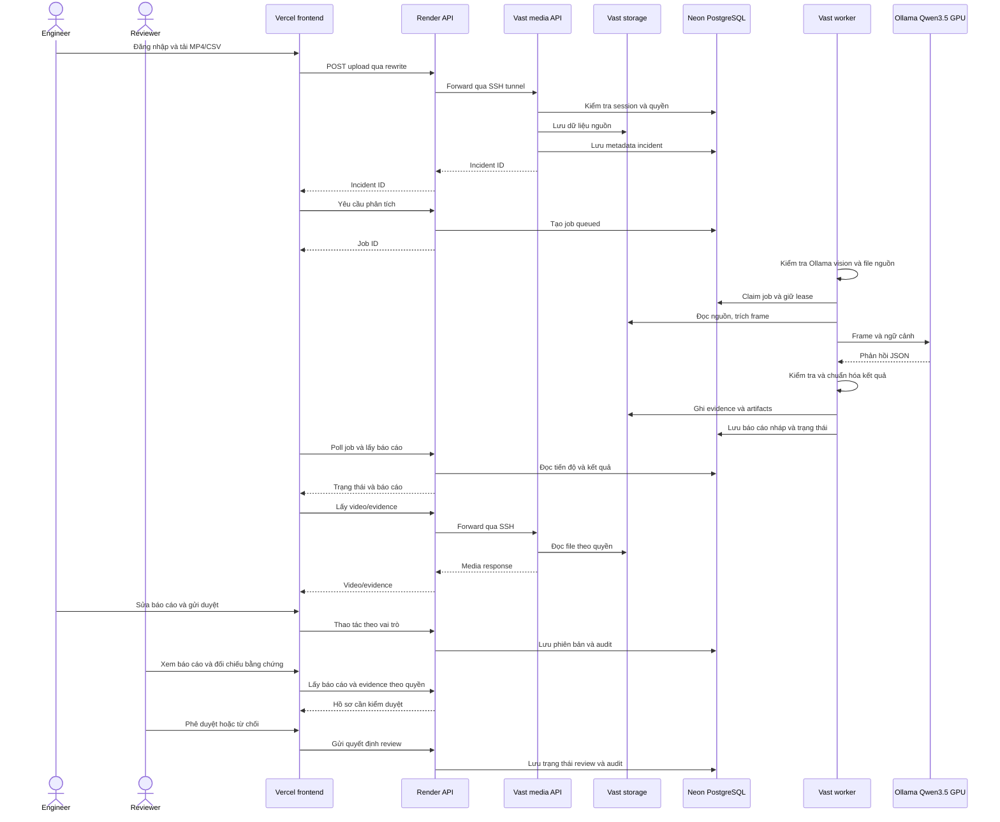

# Kiến trúc IncidentLens: Vercel, Render, Neon và Vast.ai

Kiến trúc được nhóm xác nhận: frontend trên Vercel; worker và Qwen3.5 chạy trên GPU Vast.ai. Source triển khai API Render qua `deploy/render_start.py`, sử dụng private SSH media tunnel. Tài liệu mô tả luồng V1 hiện hành, không xác nhận trạng thái live của deployment.

## Sơ đồ triển khai

## Trách nhiệm và cấu hình

| Thành phần | Trách nhiệm | Cấu hình |
|---|---|---|
| Engineer | Tạo hồ sơ, yêu cầu phân tích, chỉnh sửa và gửi duyệt | Quyền `incident:create`, `analysis:create`, `report:edit`, `report:submit` |
| Reviewer | Xem hồ sơ, đối chiếu bằng chứng, phê duyệt hoặc từ chối | Quyền `incident:read`, `report:approve`, `report:reject`; kiểm tra tại backend |
| Vercel / Next.js | Giao diện, upload, polling, review; rewrite API cùng origin | [Frontend env mẫu](../frontend/.env.example), [rewrite](../frontend/next.config.mjs) |
| Render / FastAPI | Auth, phân quyền, incident/job/report/audit; chuyển các route media V1 sang Vast | [API env mẫu](../.env.example), [app](../api/main.py), [media proxy](../api/gpu_media_proxy.py) |
| Render SSH supervisor | Forward loopback Render 18000 tới loopback Vast 18000, tự nối lại tunnel | [render_start.py](../deploy/render_start.py) đọc các biến `GPU_SSH_*` từ môi trường tiến trình |
| Neon PostgreSQL | Incident, queue, report/version, evidence metadata, user/session/audit dùng chung | Render và Vast phải dùng cùng database/schema và migration |
| Vast media service | Lưu upload, phục vụ media/telemetry/evidence trong route scope | [api.gpu_media](../api/gpu_media.py), bind `127.0.0.1:18000` |
| Vast GPU worker | Claim job V1 có file nguồn, gọi pipeline và ghi kết quả | [gpu_worker.py](../backend/gpu_worker.py), [job processing](../backend/worker.py) |
| Vast Ollama | Suy luận vision-language bằng `qwen3.5:9b` trên GPU | Endpoint `http://127.0.0.1:11434/v1/chat/completions`; `QWEN_REASONING_EFFORT=none` |
| Vast media storage | MP4, CSV, frame/clip và artifacts | Cùng `INCIDENT_STORAGE_DIR` cho media service và worker |

Render không chạy worker hoặc model trong cấu hình này. Địa chỉ `127.0.0.1` ở trên thuộc server tương ứng, không phải máy cá nhân của người xem frontend.

## Luồng dữ liệu V1

Sơ đồ thể hiện luồng thành công, polling có thể diễn ra đồng thời với worker. Trạng thái job, trạng thái kiểm duyệt và phạm vi quan sát của AI là các khái niệm riêng.

## Giới hạn triển khai cần giữ rõ

- [GPU media proxy](../api/gpu_media_proxy.py) chỉ chuyển một tập route V1: upload, video, telemetry, review context, evidence media và job diagnostics. Không suy ra V2 đã dùng chung pipeline lưu file từ xa.
- `backend.gpu_worker` chỉ chạy V1; frontend giữ `NEXT_PUBLIC_ENABLE_V2_WORKSPACE=false` cho topology này.
- Khi Vast/tunnel offline, các route upload/media được proxy có thể trả `503 GPU_UNAVAILABLE`. Review context có nhánh fallback về API. Không mô tả offline như toàn hệ thống vẫn upload bình thường.
- Worker kiểm tra model và file nguồn trước khi claim. Nếu inference lỗi giữa chừng, kết quả phụ thuộc xử lý lỗi/timeout hiện có; không hứa tự resume mọi job.
- Neon dùng chung chỉ đồng bộ metadata. File phải ở storage Vast để worker đọc được.
- [Installer](../deploy/vast/install_worker.sh) tự bật media service, nhưng worker có `autostart=false`. Cần chủ động start worker sau khi env, media và model sẵn sàng.
- Render phải dùng entry point `python -m deploy.render_start` để có tunnel; lệnh Uvicorn đơn lẻ không khởi tạo SSH tunnel.

## Quyết định kỹ thuật

1. Tách suy luận khỏi API web: worker và model ở GPU, API giữ request/metadata/review.
2. Dùng PostgreSQL làm queue có trạng thái, claim/lease và heartbeat; chưa cần thêm Redis.
3. Đặt media cạnh worker trên Vast để đọc video/frame trực tiếp; Render truy cập qua SSH có giới hạn route và host key.
4. AI tạo bản nháp; con người đối chiếu bằng chứng và quyết định phê duyệt.
5. Giữ V2 và RAG ngoài luồng triển khai hiện tại cho đến khi storage, identity và evaluation được tích hợp tương ứng.

## Tài liệu vận hành

- [README và cấu hình theo từng dịch vụ](../README.md)
- [Vast worker/media env mẫu](../deploy/vast/worker.env.example)
- [Settings validation](../backend/config.py)

Các hướng dẫn all-in-one Qwen2.5/SQLite và VPS/Caddy cũ không phải quy trình chạy topology này. Kiểm tra health chỉ chứng minh từng dịch vụ phản hồi; cần hồ sơ thật được phép dùng để xác nhận end-to-end.
